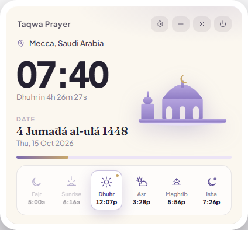
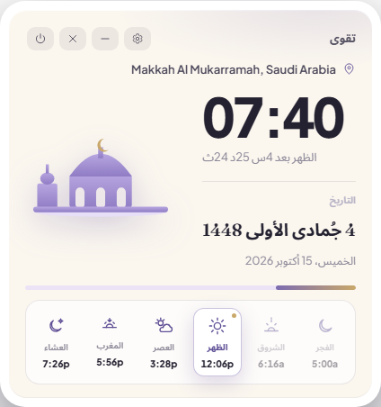
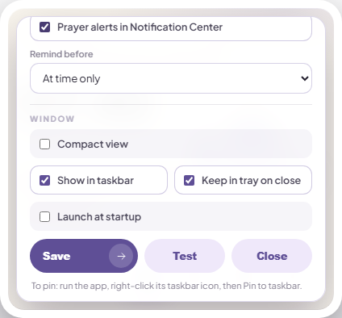

# Taqwa Prayer (تقوى) — Windows Prayer Times Widget

Compact frameless desktop widget (Electron) for Islamic prayer times: location, live clock + countdown to next prayer, Hijri/Gregorian date, and a 6-prayer timeline. Notifications land in Windows Notification Center; the taskbar icon shows day progress and a Jump List of today's times.

## Screenshots

| English | العربية (RTL) |
|---|---|
|  |  |



## Features
- Compact card: ♡ location, big time, `Fajr in 20m 09s` countdown, date block, mosque mark
- Timeline: Fajr / Sunrise / Dhuhr / Asr / Maghrib / Isha with line icons, next highlighted, past dimmed, day-progress bar
- Live times via Al-Adhan `timingsByCity` API (any city + method), offline fallback included
- Notifications: at-time alert + optional 5/10/15/30-min reminder, once per day, in Notification Center
- Taskbar: pinnable icon, progress bar, Jump List with today's times, tray menu (show/hide, startup, tray-on-close)
- Settings sheet: city, country, method, notifications, taskbar, startup

## Run (dev)

```powershell
npm install
npm start        # desktop widget
npm run dev      # with devtools
```

Internet needed for live times (offline falls back to sample times + Intl Hijri).

## Windows installer

```powershell
npm run dist-win   # -> dist/Taqwa Prayer Setup 1.0.0.exe (NSIS)
```

Installs with desktop + Start Menu shortcuts, `com.taqwa.prayer` app ID so Notification Center grouping works. After launching: right-click taskbar icon → Pin to taskbar. Enable "Launch at startup" from the in-widget settings or tray menu.

## Files
- `main.js` / `preload.js` — frameless widget window, tray, toasts, taskbar, Jump List
- `index.html` / `styles.css` / `app.js` — compact UI, line-icon set, Al-Adhan + countdown + alerts
- `build/make-icon.py` — regenerates `build/icon.png` + `build/icon.ico`
